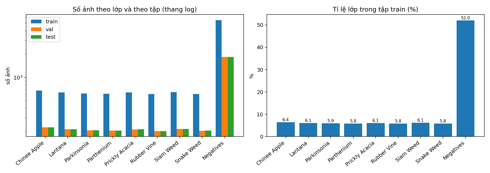
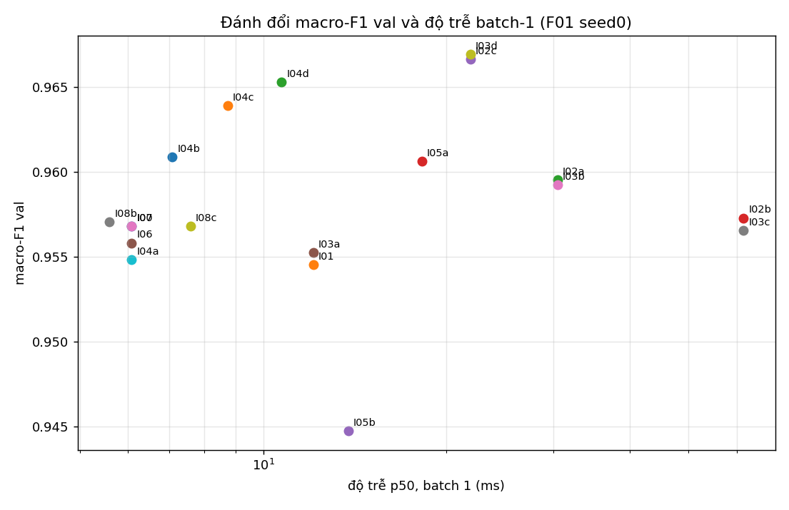
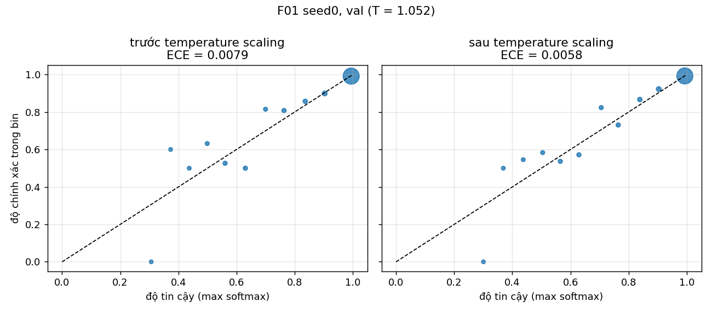
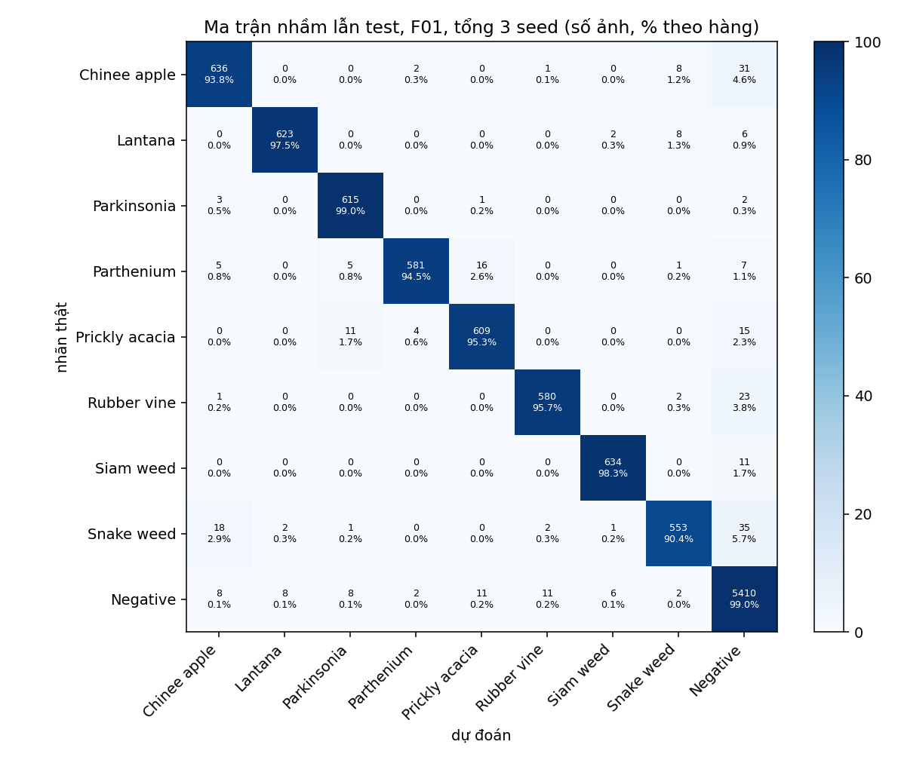
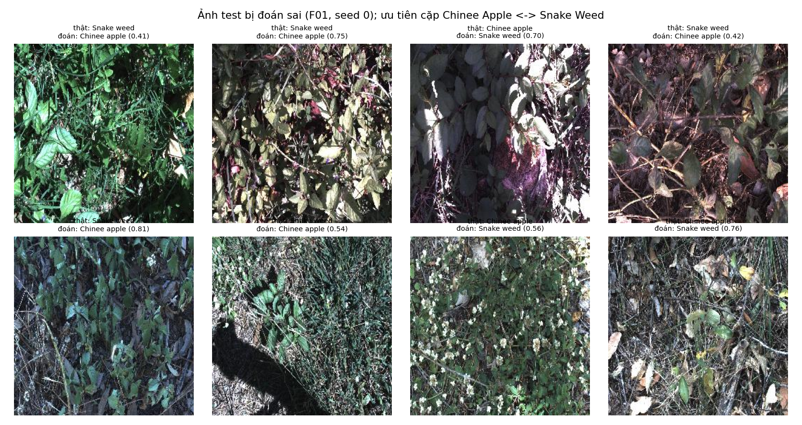

# Báo cáo Lab Day 2: Backbone, công thức huấn luyện và suy luận trên DeepWeeds

> **Trạng thái: KHUNG BÁO CÁO, CHƯA CÓ SỐ.** Mọi chỗ ghi `[SỐ ...]` hoặc `<!-- TODO ... -->` phải được điền từ log chạy thật
> (`results.xlsx`, `report_tables.md`, `scores/`). Không điền số từ bài báo hay slide như thể là kết quả của mình
> (README mục 6). Các bảng markdown đã được sinh sẵn trong `report_tables.md` bằng `code/results.py`: chỉ cần dán.
> Xoá khối trích dẫn này khi nộp.

**Họ tên:** Nguyễn Cảnh Duy · **MSSV:** 2A202602815 · **Link notebook (Kaggle/Colab):** `<!-- TODO -->`

---

## 1. Tóm tắt

<!-- TODO (≤ 10 dòng), viết SAU KHI có số: bài toán; số thí nghiệm đã làm (B, T, I, F); cấu hình tốt nhất;
     macro-F1 test và top-1 test (mean ± std, 3 seed); Δ so với mốc T00 + I00 và có vượt nhiễu không; kết luận chính. -->

- Bài toán: phân loại 9 lớp ảnh cỏ dại DeepWeeds (17.509 ảnh 256×256), fold 0 chia sẵn.
- Cấu hình tốt nhất: `[SỐ: backbone + công thức + suy luận]`.
- Kết quả test (mean ± std, `[SỐ]` seed): macro-F1 `[SỐ]`, top-1 `[SỐ]`, ECE `[SỐ]`.
- So với mốc `T00 + I00`: Δ macro-F1 = `[SỐ]` (std lớn hơn s = `[SỐ]`) → `[vượt / không vượt nhiễu]`.
- Kết luận chính: `<!-- TODO -->`.

## 2. Dữ liệu và thiết lập

**Dữ liệu.** DeepWeeds (Olsen và cộng sự, 2019): 17.509 ảnh, 9 lớp (8 loài + Negatives). Dùng **fold 0 chia sẵn**
(`train_subset0/val_subset0/test_subset0.csv`, tỉ lệ 60/20/20), không sửa, không chia lại.
Phân bố lớp:  · Ảnh mẫu: `figures/samples_per_class.png`.
`<!-- TODO: dán bảng figures/class_counts.csv; nhận xét lệch lớp (Negatives chiếm khoảng một nửa), đối chiếu Table 1 của bài báo: ghi rõ đó là số trích dẫn -->`

**Quy ước chống rò rỉ (S1–S6).** Mọi lựa chọn (backbone, công thức, bộ view TTA, nhiệt độ T, cấu hình thời gian thực)
dùng **val**. Test chỉ được mở ở `code/final.py`, **đúng một lần cho mỗi (exp_id, seed)**, có chốt chặn
`test_started.json`. Nhiệt độ T khớp trên val cho từng seed. Kết quả: `figures/split_check.json`.

**Chỉ số.** macro-F1 (chính), top-1, balanced accuracy, ECE 15 bin, NLL, tính bằng `eval.py` gốc của repo
(không sửa); std lấy mẫu (ddof = 1) qua seed.

**Công thức nền `T00`** (mọi thí nghiệm chỉ khác `T00` một yếu tố): `<!-- TODO: dán từ logs/T00/seed0/config.json:
fine-tune toàn mạng, AdamW, LR backbone/head, weight decay (không áp dụng cho norm/bias), warmup + cosine theo bước,
epoch, batch, AMP, augmentation cơ bản, CE -->`.

**Môi trường.** GPU: `[SỐ/TÊN: logs/*/seed*/summary.json → gpu]` · torch `[…]` · timm `[…]` · Python `[…]` · seed: 0, 1, 2
(seed 0 dùng cho mọi so sánh trong Bước 1-3; 3 seed cho T00 và chung kết).
**Ngân sách:** `<!-- TODO: nếu có hạ epoch/bỏ thí nghiệm nào, ghi rõ ở đây (GUIDE mục 7) -->`.

**Quy tắc chọn (đặt trước khi xem kết quả, nằm trong `code/experiments.py`):**

| Quyết định | Quy tắc |
|---|---|
| Backbone chính | macro-F1 val ≥ (tốt nhất − 0,003); trong số đó chọn mạng có độ trễ batch-1 thấp nhất |
| Yếu tố thắng | Δ = F1 val (yếu tố) − F1 val (T00, seed 0) ≥ max(2·std_T00, 0,003) |
| Kết hợp T20 | ghép yếu tố thắng tốt nhất mỗi "ô", bỏ cặp xung đột (T09 với T10); trục G (độ phân giải, epoch) chỉ phân tích |
| Công thức cuối | trong {T00, yếu tố thắng, T20}: F1 val cao nhất; nếu chênh nhỏ hơn ngưỡng thì chọn cái ít thay đổi nhất |
| Bộ view TTA | bộ có F1 val cao nhất, chỉ nhận nếu hơn I00 ≥ 0,002; hoà thì ít view hơn |
| Thời gian thực | p95 batch-1 ≤ 100 ms và F1 val không kém I00 quá 0,002; chọn p95 thấp nhất |

Kết quả các quyết định: `decisions.json`.

## 3. Kết quả so sánh backbone

`<!-- TODO: dán bảng "Backbone (B)" từ report_tables.md (7 mạng, 4 họ, cùng T00, cùng seed 0, tag trọng số ghim). -->`

 <!-- TODO: nếu muốn thêm biểu đồ F1 theo #tham số cho backbone, vẽ từ sheet Backbones -->

Nhận xét: `<!-- TODO: mạng nào tốt nhất; khoảng cách có lớn hơn nhiễu (std_T00) không; vì sao chọn backbone chính
(quy tắc trên); ViT/Swin có chậm hơn/được lợi từ độ phân giải 224 không (liên hệ slide); chú ý: B-run chỉ 1 seed,
chênh nhỏ hơn std_T00 thì nói "không phân biệt được". -->`

## 4. Kết quả công thức huấn luyện

`T00` chạy 3 seed: macro-F1 val = `[SỐ]`, std_T00 = `[SỐ]`; ngưỡng thắng = `[SỐ]` (từ `decisions.json`).

`<!-- TODO: dán bảng "Công thức huấn luyện (T)" (Δ và Δ/std). -->`

| Trục | Yếu tố | Δ macro-F1 val | Δ/std | Kết luận |
|---|---|---|---|---|
| A khởi tạo | T01 frozen, T02 scratch | `[SỐ]` | `[SỐ]` | `<!-- giúp / không phân biệt được / hại, vì sao -->` |
| B augmentation | T03, T04, T05, T06 | `[SỐ]` | `[SỐ]` | |
| C loss | T07, T08, T09 | `[SỐ]` | `[SỐ]` | |
| D sampler | T10 | `[SỐ]` | `[SỐ]` | |
| E LR | T11 | `[SỐ]` | `[SỐ]` | |
| F EMA | T12 | `[SỐ]` | `[SỐ]` | |
| G độ phân giải | T13 | `[SỐ]` | `[SỐ]` | |
| Kết hợp | T20 | `[SỐ]` | `[SỐ]` | cộng dồn hay triệt tiêu? |

Nhận xét: `<!-- TODO: yếu tố nào giúp, nào không, giải thích (liên hệ slide: "công thức quan trọng ngang kiến trúc");
chú ý F1 các lớp hiếm (Chinee Apple, Snake Weed) có đổi không dù macro-F1 tổng không đổi. -->`
Đường cong huấn luyện từng thí nghiệm: `curves/<exp_id>_*.png`.

## 5. Kết quả suy luận

`<!-- TODO: dán bảng "Suy luận (I)" (≥ 4 phương pháp ngoài I00) và bảng độ trễ p50/p95/p99 (sheet Latency, kèm GPU, dtype, gộp BN). -->`

 

- TTA/ensemble: tăng macro-F1 val `[SỐ]` với chi phí `[SỐ]`× độ trễ so với I00; `<!-- có đáng không -->`.
- Hiệu chuẩn: ECE test trước TS = `[SỐ]`, sau TS = `[SỐ]` (T khớp trên val). Ước lượng ECE trên val khi T khớp cũng trên val
  bị lạc quan; sheet `Inference` (I07) có ECE theo cross-fit 2 fold.
- Gộp BN + FP16: sai số đầu ra `[SỐ]`, độ trễ `[SỐ]` → `<!-- TODO -->`.

## 6. Cấu hình tốt nhất

**Mô tả để tái lập:** backbone `[SỐ/TÊN + tag trọng số]` · công thức `[các yếu tố]` · suy luận `[view, gộp xác suất/logit, T]` ·
seed 0, 1, 2 · `decisions.json` + `logs/F01/seed*/config.json`.

`<!-- TODO: dán bảng "Chung kết và mốc (test)", "So với mốc" và "Theo lớp (test)" từ report_tables.md. -->`

Điểm tự chấm theo `eval.py grade` (phần I, đề xuất): xem `scores/grade_I.md`.

Phân tích lỗi: `<!-- TODO: cặp bị nhầm nhiều nhất (scores/top_confusions.csv); Chinee Apple ↔ Snake Weed;
nhìn ảnh sai (figures/errors_test.png) có nguyên nhân dễ thấy không (nền, ánh sáng, vật thể nhỏ, nhãn nhiễu). -->`
Lưu ý: phân tích này chỉ để mô tả; **không** dùng để sửa cấu hình rồi chạy lại test.

## 7. Kết luận và khuyến nghị

1. **Cấu hình tốt nhất?** `[SỐ]`; tốt hơn mốc `[SỐ]` macro-F1, `[vượt / không vượt]` nhiễu (s = `[SỐ]`).
2. **Yếu tố đóng góp nhiều nhất** (backbone, công thức huấn luyện hay suy luận)? `<!-- TODO: so các Δ trong mục 3-5 với std -->`.
3. **Triển khai robot, ngân sách 30–100 ms/khung:** chọn `[cấu hình thời gian thực, p95 = SỐ ms, GPU = TÊN]`, macro-F1 test `[SỐ]`
   (`F01rt`). Độ trễ đo **chưa gồm** tiền xử lý ảnh và đọc đĩa. `<!-- TODO: khuyến nghị cụ thể -->`

## 8. Hạn chế và việc tiếp theo

- Một fold (fold 0), `[SỐ]` seed: khoảng tin cậy rộng; chênh lệch nhỏ hơn nhiễu không kết luận được.
- Ablation chỉ trên backbone chính và seed 0; tương tác giữa backbone và công thức chưa kiểm chứng.
- `<!-- TODO: các yếu tố chưa thử; lệch phân phối (miền khác, mùa khác, camera khác); nhãn nhiễu; độ trễ chưa gồm tiền xử lý -->`
- Các thí nghiệm không chạy / hạ ngân sách: `<!-- TODO hoặc "không có" -->`.

## 9. Phụ lục

- Danh sách `exp_id` và cấu hình đầy đủ: `results.xlsx` (sheet `Backbones`, `Training`, `Inference`, `Final`) và `logs/*/seed*/config.json`.
- Kết quả bước kiểm tra pipeline: `figures/sanity.json`, `figures/augmentation_preview.png`, `figures/sanity_overfit.png`.
- Notebook: `code/lab_day2.ipynb` · Link chạy lại: xem `README.md`.
- Công cụ hỗ trợ: `<!-- TODO: nêu rõ nếu có dùng trợ lý AI để viết/rà code theo quy định của lớp -->`.
